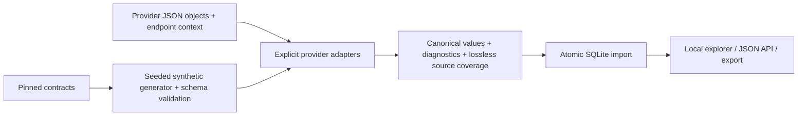

# Tada · Payroll Data Normalization

I built this project to normalize company, employee, direct-deposit, deduction, and payroll data from **PrismHR, isolved, and UKG Ready** into one consistent model.

I chose **Python and SQLite** because I wanted the project to be easy to run locally without setting up a database server or relying on live API access. The CLI handles normalization and imports, SQLite stores the relationships, and a small browser UI lets me inspect the results.

My main goal was to preserve what each provider actually means. I use explicit mappings for common fields, decimal strings for money, and diagnostics when a value is ambiguous. I also keep every source field so I can trace a result back to its input instead of silently dropping data.

## My approach

I started with the supplied provider specifications and lookup references. I kept isolved's primary snapshot separate from its alternate version, and treated UKG's cached pages as documentation rather than assuming they were a complete OpenAPI contract.

From there, I designed canonical entities for companies, employees, deposit and deduction setup, payroll runs, and paychecks. I kept provider-specific fields as explicit extensions when there wasn't enough evidence to give them a shared meaning. The [employee field inventory](docs/EMPLOYEE_FIELD_COVERAGE.md) shows exactly where that boundary is.

I generated my own deterministic fixtures, validated them against the selected source schemas, and tested the transformations and database behavior. I then used the organizer's demo APIs to check the mappings against live responses. The [requirement audit](docs/REQUIREMENTS.md) and [test results](docs/TESTING.md) summarize what I verified and what remains limited.

## Run locally

My local setup uses **Python 3.10+** and Python's built-in SQLite support. The steps below run the complete synthetic demo without an API key, cloud account, database server, or third-party runtime package.

```bash
git clone https://github.com/tanikellapratik23/tada-normalization.git
cd tada-normalization
python3 -m tada ingest fixtures/synthetic.json
python3 -m tada serve
```

Open **http://127.0.0.1:8080**. The supplied synthetic dataset contains **21 records across all three providers**, including linked companies, employees, deposit/deduction configurations, payroll runs, paychecks and UKG employee supplements. Filter by provider/entity and expand a record to see canonical values, diagnostics, source fields and coverage. Stop with Ctrl-C.

The importer creates `local/tada.sqlite`. Re-importing the same fixtures updates the same record IDs rather than creating duplicates. All state remains local.

## Validate and test

```bash
python3 -m venv .venv
source .venv/bin/activate             # Windows: .venv\Scripts\activate
python -m pip install -e '.[test]'
python -m tada generate              # deterministic seed 42
python -m tada validate fixtures/synthetic.json
python -m unittest discover -s tests -v
```

The suite currently has **48 tests** covering source-schema compatibility, canonical output constraints, exact decimals, field preservation, unknown enums, missing/null/zero distinctions, date errors, status-domain separation, deposit allocation semantics, paycheck versus YTD values, UKG units, relationship integrity, rollback, idempotency and HTTP behavior. GitHub Actions runs the same checks on Python 3.10, 3.12 and 3.13.

## CLI

```bash
# Transform without a database
python3 -m tada normalize fixtures/synthetic.json --output local/normalized.json

# Persist an entire batch atomically
python3 -m tada ingest fixtures/synthetic.json --db local/tada.sqlite

# Export all persisted canonical records
python3 -m tada export --output local/export.json

# Reject any diagnostic, useful when reviewing a fully resolved dataset
python3 -m tada normalize fixtures/synthetic.json --strict
# Expected to fail: the fixture corpus intentionally demonstrates documented uncertainties.

# Regenerate fixtures or the complete employee field inventory
python3 -m tada generate --seed 42
python3 scripts/build_mapping_report.py
```

Commands exit nonzero on errors. A failed import rolls back the whole transaction. Default normalization preserves ambiguous data and emits diagnostics; `--strict` makes those diagnostics fatal. Source schema validation is a separate command and is not silently substituted for semantic validation.

## Input format

An input file is an array of envelopes. `record` is one provider object extracted from the documented endpoint response, **not a fabricated canonical input**. Supply company/employee/run scope from the endpoint request where the response omits it.

```json
[
  {
    "provider": "isolved",
    "entity": "direct_deposit",
    "context": {
      "tenant_id": "client-42",
      "company_id": "legal-7",
      "employee_id": "101"
    },
    "record": {
      "id": 201,
      "accountNumber": "000000000001",
      "accountType": "Checking",
      "percent": 25,
      "sequenceNumber": 1
    }
  }
]
```

This example can be normalized independently. To **ingest** it, import its company and employee parents too. Identity components are strings; original identifiers are retained. For endpoint objects without IDs, provide a stable `context.record_id`. For isolved/UKG paycheck run links, supply `context.payroll_run_id`; a run sequence number is not a run ID.

Available entities: `company`, `employee`, `direct_deposit`, `deduction`, `payroll_run`, `paycheck`; UKG additionally supports `compensation`, `pay_info`, and `demographics` as employee-linked supplements. The source binding registry and response extraction guidance are in [docs/MAPPINGS.md](docs/MAPPINGS.md).

Tenant status dictionaries can be supplied as `context.employment_status_map`, e.g. `{"Working":"active"}`, or `deposit_status_map`. Only supply meanings verified for that tenant. Without them, undocumented status labels remain `unknown`; spelling alone is not treated as evidence.

## Canonical model

Each record contains:

| Field | Purpose |
| --- | --- |
| `schema_version`, `entity`, `id` | Versioned type and scoped identity |
| `company_id`, `employee_id`, `payroll_run_id` | Relevant relational links |
| `source` | Provider, tenant, company and source record ID |
| `data` | Common semantic fields and explicitly named provider structures |
| `diagnostics` | Invalid values, unknown meanings and evidence gaps |
| `extensions` | Every unmapped source leaf, keyed by escaped JSON Pointer |
| `source_record` | Complete input object for audit/reprocessing |
| `field_coverage` | Source-leaf pointer to canonical destination or extensions |

[schemas/canonical-v1.schema.json](schemas/canonical-v1.schema.json) defines the envelope and important financial/status constraints. The schema permits provider-specific data structures; it is not a claim that every extension has equivalent semantics across providers.

Employee common fields cover names/contact/address, employment dates and status, job and organizational assignments, and compensation. **All received employee fields are retained**, with the exact mapping boundary listed in [docs/EMPLOYEE_FIELD_COVERAGE.md](docs/EMPLOYEE_FIELD_COVERAGE.md). Provider-specific fields remain explicit extensions rather than being silently discarded or given invented meanings.

Money, rates and percentages are decimal strings. Percentages are percentage points where the provider documents that basis. No default currency, FX conversion, annualization or payroll calculation is performed. UKG paycheck gross/net totals are deliberately absent because the selected cached schema does not supply them.



## Local API

The read-only server binds to loopback, with no external assets:

- `GET /health`
- `GET /api/stats`
- `GET /api/records?provider=prismhr&entity=employee&limit=50&offset=0`

`company_id` filtering is also supported. `limit` is 1–1000; results are ordered by ID. The explorer displays full imported data and is intended for local review, not public deployment.

## What I tested against the live APIs

I tested sign-in for all three providers and then made read-only requests for company, employee, deposit, deduction, payroll and paycheck data where the demo accounts exposed it. The live checker also sends returned sample records through the same adapters and checks that every source field is retained.

The saved [live results](docs/LIVE_API_RESULTS.json) contain endpoint templates, statuses and counts only—no API key, tokens, employee records or account data. In the recorded run, I normalized **16 sampled records** with complete source-field preservation. Some endpoints returned empty lists. The documented isolved payroll-history route and UKG employee deduction-list route returned **404**. Those remain documented live-access gaps, not passing tests. The offline fixtures and tests still cover those record types.

To repeat the live smoke test, install the test dependencies above, set the organizer's key locally, and run:

```bash
# Enter the key without echoing it or saving it in shell history (Bash):
read -r -s -p "Demo API key: " DEMO_SIGNIN_API_KEY; echo
export DEMO_SIGNIN_API_KEY
python -m tada.live_check --year 2026 --report local/live-check.json
unset DEMO_SIGNIN_API_KEY
```

The command signs in afresh, uses bounded requests and caps retries for rate limits. It returns a nonzero exit status if an endpoint is unavailable or a check fails. An empty response is marked separately from successful record validation. It is a smoke test, not a full synchronization service; no live records are written to disk by this command.

## AI Assistance

I used **Claude Code** as my primary AI development assistant throughout this project to accelerate research, implementation, testing, and documentation.

- **API Research:** Analyzed PrismHR, isolved, and UKG Ready documentation to identify field mappings and schema differences.
- **Development:** Assisted with code implementation, debugging, refactoring, and identifying normalization edge cases.
- **Testing:** Helped develop synthetic test scenarios and identify inconsistencies across provider data.
- **Documentation:** Assisted in organizing technical explanations and documenting implementation decisions.

**Engineering Ownership:** Claude Code served as a development assistant, not a source of truth. I maintained responsibility for architectural decisions, canonical schema design, mapping logic, and validating results against provider specifications and local tests.

Codex also assisted with implementation, the final requirement audit, live API checks, regression testing, and repository publication.

## Decisions and limits

I documented the assumptions, source inconsistencies and limitations in [ASSUMPTIONS.md](ASSUMPTIONS.md). In particular, some tenant-defined codes and provider-specific fields remain explicit extensions; UKG's selected paycheck schema does not supply gross/net totals; and live API availability differs from the cached references. I haven't implemented the optional provider write-back extension.

The original reference pack, notices and PrismHR license remain in `contracts/`. My mapping evidence is in [docs/MAPPINGS.md](docs/MAPPINGS.md).
