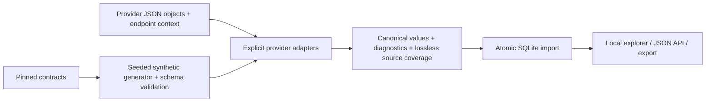

# Tada · Payroll Data Normalization

A local platform that transforms **PrismHR, isolved, and UKG Ready** company, employee, direct-deposit, deduction, payroll-run and paycheck data into an auditable canonical model.

The emphasis is preserving meaning: exact decimals, explicit provider mappings, scoped relationships, unknown-code diagnostics, and a record of where every source field went. A CLI imports and exports JSON; SQLite stores linked records; a local browser explorer lets reviewers inspect the results.

## Run locally

Requires **Python 3.10+**. No API key, cloud account, database server, or third-party runtime package is needed.

```bash
git clone https://github.com/tanikellapratik23/tada-normalization.git
cd tada-normalization
python3 -m tada ingest fixtures/synthetic.json
python3 -m tada serve
```

Open **http://127.0.0.1:8080**. The supplied synthetic dataset contains **21 records across all three providers**, including linked companies, employees, deposit/deduction configurations, payroll runs, paychecks and UKG employee supplements. Filter by provider/entity and expand a record to see canonical values, diagnostics, source fields and coverage. Stop with Ctrl-C.

The importer creates `local/tada.sqlite`. Re-importing the same fixtures updates the same record IDs rather than creating duplicates. All state remains local.

## Validate and test

```bash
python3 -m venv .venv
source .venv/bin/activate             # Windows: .venv\Scripts\activate
python -m pip install -e '.[test]'
python -m tada generate              # deterministic seed 42
python -m tada validate fixtures/synthetic.json
python -m unittest discover -s tests -v
```

Tests cover source-schema compatibility, canonical output constraints, exact decimals, field preservation, unknown enums, missing/null/zero distinctions, date errors, status-domain separation, deposit allocation semantics, paycheck versus YTD values, UKG units, relationship integrity, rollback, idempotency and HTTP behavior. GitHub Actions runs the same checks on Python 3.10, 3.12 and 3.13.

## CLI

```bash
# Transform without a database
python3 -m tada normalize fixtures/synthetic.json --output local/normalized.json

# Persist an entire batch atomically
python3 -m tada ingest fixtures/synthetic.json --db local/tada.sqlite

# Export all persisted canonical records
python3 -m tada export --output local/export.json

# Reject any diagnostic, useful when reviewing a fully resolved dataset
python3 -m tada normalize fixtures/synthetic.json --strict
# Expected to fail: the fixture corpus intentionally demonstrates documented uncertainties.

# Regenerate fixtures or the complete employee field inventory
python3 -m tada generate --seed 42
python3 scripts/build_mapping_report.py
```

Commands exit nonzero on errors. A failed import rolls back the whole transaction. Default normalization preserves ambiguous data and emits diagnostics; `--strict` makes those diagnostics fatal. Source schema validation is a separate command and is not silently substituted for semantic validation.

## Input format

An input file is an array of envelopes. `record` is one provider object extracted from the documented endpoint response, **not a fabricated canonical input**. Supply company/employee/run scope from the endpoint request where the response omits it.

```json
[
  {
    "provider": "isolved",
    "entity": "direct_deposit",
    "context": {
      "tenant_id": "client-42",
      "company_id": "legal-7",
      "employee_id": "101"
    },
    "record": {
      "id": 201,
      "accountNumber": "000000000001",
      "accountType": "Checking",
      "percent": 25,
      "sequenceNumber": 1
    }
  }
]
```

This example can be normalized independently. To **ingest** it, import its company and employee parents too. Identity components are strings; original identifiers are retained. For endpoint objects without IDs, provide a stable `context.record_id`. For isolved/UKG paycheck run links, supply `context.payroll_run_id`; a run sequence number is not a run ID.

Available entities: `company`, `employee`, `direct_deposit`, `deduction`, `payroll_run`, `paycheck`; UKG additionally supports `compensation`, `pay_info`, and `demographics` as employee-linked supplements. The source binding registry and response extraction guidance are in [docs/MAPPINGS.md](docs/MAPPINGS.md).

Tenant status dictionaries can be supplied as `context.employment_status_map`, e.g. `{"Working":"active"}`, or `deposit_status_map`. Only supply meanings verified for that tenant. Without them, undocumented status labels remain `unknown`; spelling alone is not treated as evidence.

## Canonical model

Each record contains:

| Field | Purpose |
| --- | --- |
| `schema_version`, `entity`, `id` | Versioned type and scoped identity |
| `company_id`, `employee_id`, `payroll_run_id` | Relevant relational links |
| `source` | Provider, tenant, company and source record ID |
| `data` | Common semantic fields and explicitly named provider structures |
| `diagnostics` | Invalid values, unknown meanings and evidence gaps |
| `extensions` | Every unmapped source leaf, keyed by escaped JSON Pointer |
| `source_record` | Complete input object for audit/reprocessing |
| `field_coverage` | Source-leaf pointer to canonical destination or extensions |

[schemas/canonical-v1.schema.json](schemas/canonical-v1.schema.json) defines the envelope and important financial/status constraints. The schema permits provider-specific data structures; it is not a claim that every extension has equivalent semantics across providers.

Employee common fields cover names/contact/address, employment dates and status, job and organizational assignments, and compensation. **All received employee fields are retained**, with the exact mapping boundary listed in [docs/EMPLOYEE_FIELD_COVERAGE.md](docs/EMPLOYEE_FIELD_COVERAGE.md). Provider-specific fields remain explicit extensions rather than being silently discarded or given invented meanings.

Money, rates and percentages are decimal strings. Percentages are percentage points where the provider documents that basis. No default currency, FX conversion, annualization or payroll calculation is performed. UKG paycheck gross/net totals are deliberately absent because the selected cached schema does not supply them.



## Local API

The read-only server binds to loopback, with no external assets:

- `GET /health`
- `GET /api/stats`
- `GET /api/records?provider=prismhr&entity=employee&limit=50&offset=0`

`company_id` filtering is also supported. `limit` is 1–1000; results are ordered by ID. The explorer displays full imported data and is intended for local review, not public deployment.

## How it was built

1. Inspected the assignment's pinned provider contracts, partial lookup references and UKG cached endpoint pages.
2. Defined canonical entities and conservative field/enum mappings separately from source preservation.
3. Generated deterministic synthetic objects from selected schemas, then overlaid fictional business scenarios.
4. Added schema validation, semantic edge-case tests and source-leaf coverage checks.
5. Added transactional SQLite persistence, export and a small read-only explorer.

AI assisted the implementation and documentation. No live demo records or credentials are included. The original reference pack, notices and PrismHR license remain in `contracts/`; source attribution and mapping evidence are in [docs/MAPPINGS.md](docs/MAPPINGS.md).

Read [ASSUMPTIONS.md](ASSUMPTIONS.md) for decisions, inconsistencies and limitations, especially employee extension coverage, tenant lookups, UKG units/totals, upstream extraction, and the absence of a live connector or provider write-back.
